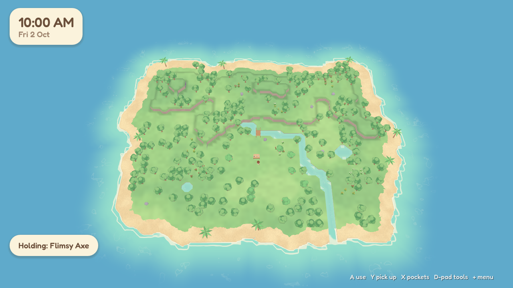
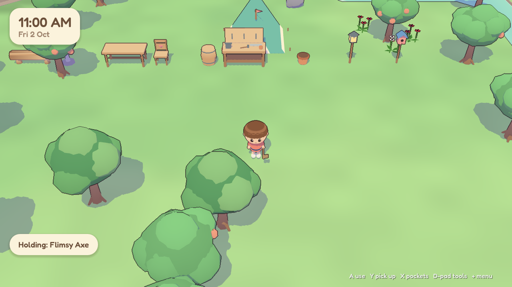
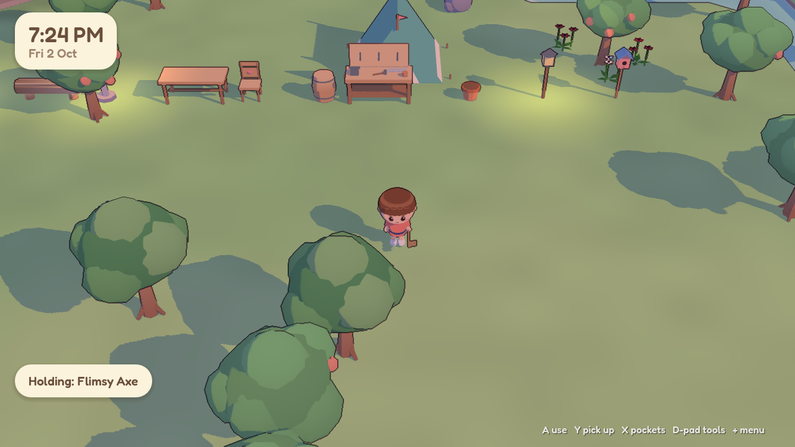
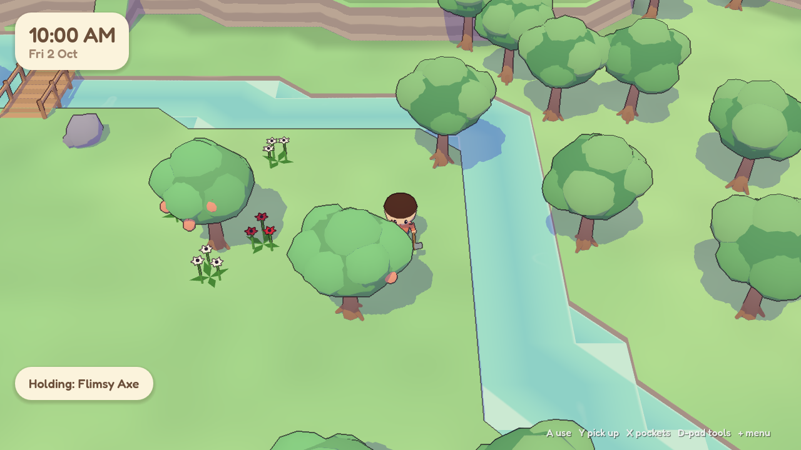
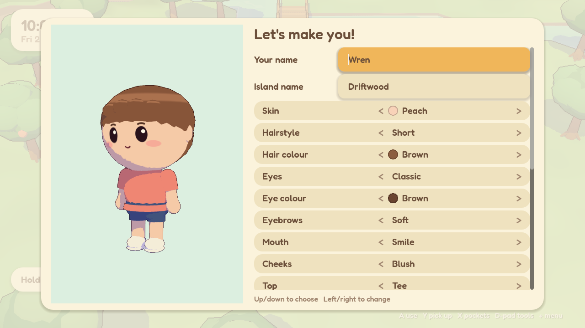
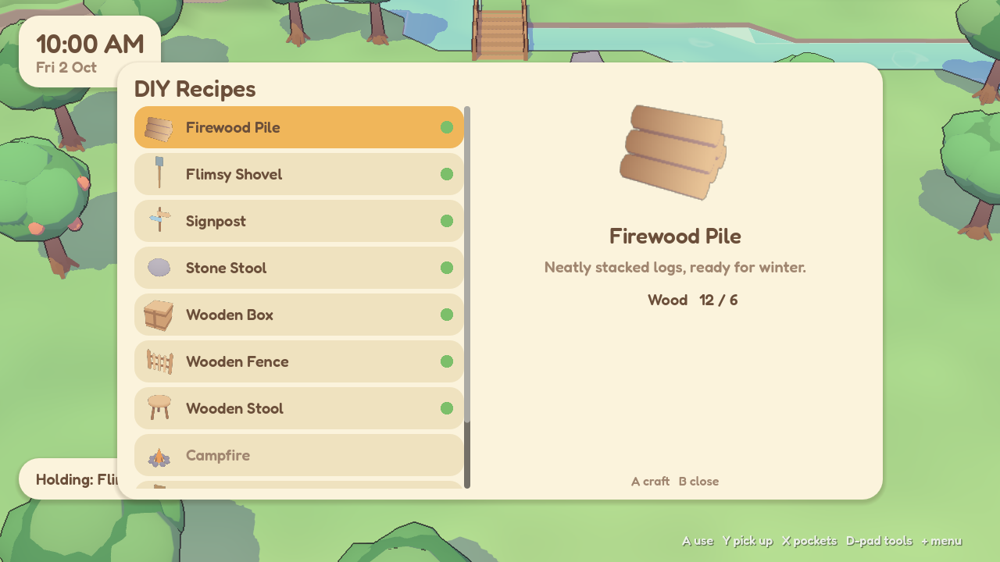
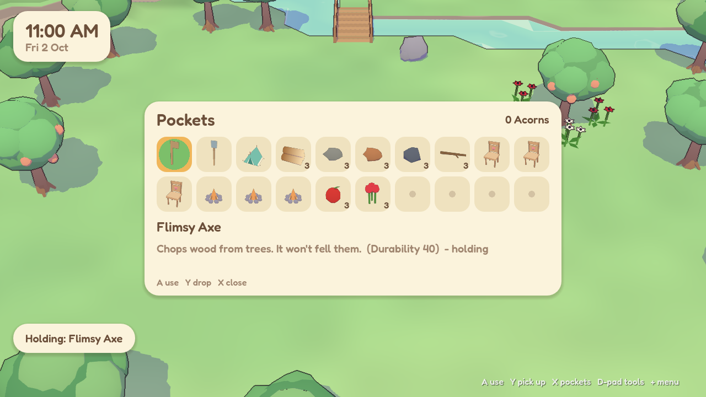
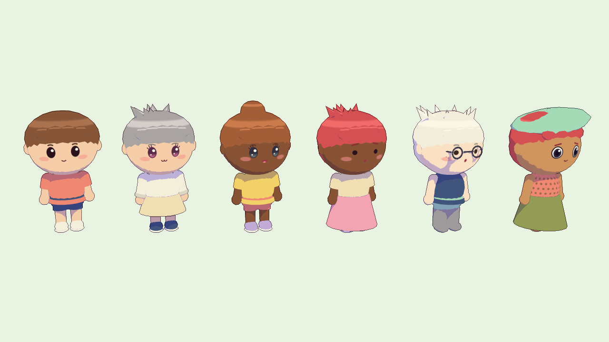

# Cosy Island

A cosy island life game about crafting and decorating, made with Godot 4.

| Decorating | Dusk | Riverside |
| --- | --- | --- |
|  |  |  |

| Character creator | DIY workbench | Pockets |
| --- | --- | --- |
|  |  |  |

## Playing

1. Install [Godot 4.7](https://godotengine.org/download) (the standard build, not .NET).
2. Open this folder in Godot and press Play, or run `godot --path .` from here.

Add `-- --new` to start a fresh island, or `-- --seed=123` for a specific one.

### Controls

| Action | Controller (Switch layout) | Keyboard |
| --- | --- | --- |
| Move | Left stick | WASD / arrows |
| Use tool, shake tree, talk to things, place | A | E / Space |
| Run, cancel | B | Shift / Esc |
| Pick up (including furniture) | Y | F |
| Pockets | X | Tab / I |
| Switch tool | D-pad left/right | Z / C |
| Rotate while placing | R | R |
| Island Phone (time travel, wardrobe, save) | + | Esc / P |

## What's in so far

- A random island from a seed: beach, cliffs, rivers with a bridge, ponds, ramps,
  a native fruit and flower. Coastlines, cliffs and riverbanks are rounded off.
- Pastel cel-shaded look with ink outlines and a day/night cycle.
- Character creator and wardrobe: 14 hairstyles, 16 hair colours, 8 eye styles,
  mouths, brows, cheeks, 8 skin tones, 9 tops with 9 patterns, bottoms, shoes,
  hats and glasses.
- Chop wood, shake trees for fruit and branches, hit rocks for stone, clay and iron
  (one rock a day gives acorns).
- DIY workbench in the plaza with 27 recipes: tools and furniture. Message bottles
  wash up each day with new recipes.
- 23 pieces of furniture to place anywhere on the grid, rotate and pick back up.
  Lanterns and campfires glow at night.
- Pockets with item icons, stacking and tools that wear out.
- Real-time clock with time travel from the Island Phone. Autosave.

See [docs/DESIGN.md](docs/DESIGN.md) for the full plan.
